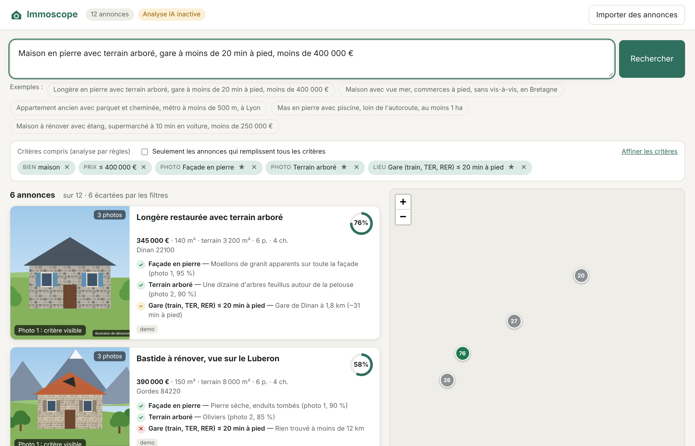

# Immoscope — recherche immobilière intelligente

Immoscope rassemble des annonces venues de vos sites habituels, puis vous permet de les chercher
**par ce qu'on voit sur les photos** et **par leur environnement réel** :

> « Longère en pierre avec terrain arboré, gare à moins de 15 min à pied, moins de 350 000 € autour de Rennes »

* **Recherche sur les photos.** Claude (vision) analyse les photos de chaque annonce et repère une
  trentaine de caractéristiques : façade en pierre, brique, bois ou colombages, toiture, bâti ancien ou
  contemporain, terrain plat, en pente ou arboré, haies, piscine, étang, vue dégagée, mer ou montagne,
  vignes, forêt, vis-à-vis, poutres, cheminée, état… Chacune est notée (confiance), justifiée, et rattachée
  à la photo où elle se voit. Pour un critère hors liste (« volets bleus », « glycine sur la façade »),
  Immoscope vérifie à la demande les photos des meilleurs résultats.
* **Recherche sur la localisation.** Pour chaque bien, Immoscope calcule la distance et le temps estimé
  à pied, à vélo ou en voiture jusqu'aux gares, métro, tram, bus, supermarchés, commerces, boulangeries,
  marchés, écoles, pharmacies, médecins, parcs, plages… et la distance aux nuisances (autoroute, voie
  ferrée). Données OpenStreetMap, sans clé.
* **Requête en langage naturel.** La phrase est convertie en critères modifiables (puces), avec un
  analyseur par règles hors-ligne si Claude n'est pas configuré.
* **Résultats expliqués.** Chaque annonce a un score et la liste de ses critères ✓ / ~ / ✕ / ?, avec la
  photo qui correspond mise en avant et une carte.



## Démarrage rapide

Python 3.10 ou plus récent.

```bash
cd immoscope
python -m venv .venv && source .venv/bin/activate     # Windows : .venv\Scripts\activate
pip install -e .
cp .env.example .env          # puis renseignez ANTHROPIC_API_KEY (facultatif pour essayer)
immoscope demo                # 12 annonces fictives illustrées, déjà analysées
immoscope serve               # http://127.0.0.1:8000
```

Sans clé API, tout fonctionne sauf l'analyse de nouvelles photos et la compréhension « avancée » des
requêtes (un analyseur par règles prend le relais). Clé : <https://console.anthropic.com/>.

## Travailler en local, faire tourner l'application sur Render

Même organisation que la supervision Workways : le code se modifie sur votre ordinateur, GitHub garde la
référence, Render fait tourner l'application en ligne et se met à jour à chaque `git push`.

**En local** (développement, essais, Claude Code avec l'extension Chrome) :

```bash
git clone https://github.com/michaelroger-ux/immoscope.git
cd immoscope
python -m venv .venv && source .venv/bin/activate     # Windows : .venv\Scripts\activate
pip install -e ".[dev]"
immoscope serve                                       # http://127.0.0.1:8000, données dans ./data
```

**En ligne, sur Render** (une seule fois) : *New* → *Blueprint* → dépôt `michaelroger-ux/immoscope`.
Render lit `render.yaml` : région Francfort, plan *Starter*, une instance, base SQLite sur un disque
persistant de 1 Go monté sur `/data`. Il demande deux secrets :

* `IMMO_PASSWORD` : le mot de passe d'accès à l'application (choisissez-en un solide) ;
* `ANTHROPIC_API_KEY` : votre clé API Claude.

L'application est en ligne quelques minutes plus tard sur `https://immoscope.onrender.com` (ou une
adresse voisine si ce nom est pris). Connectez-vous, puis **réinstallez le marque-page** depuis la version en
ligne (menu *Importer*) : il contient l'adresse du site et un jeton personnel.

**Ensuite** : modifiez en local, testez avec `pytest` et `immoscope serve`, puis `git push` : Render
redéploie tout seul. Les annonces et analyses en ligne restent sur le disque Render ; celles de votre
ordinateur restent dans `./data`. Pour envoyer vos annonces locales en ligne : bouton *Importer* → *Fichier*
avec un export JSON, ou le marque-page sur la version en ligne.

**Coût** : environ 7 $/mois pour le plan Starter, plus 0,25 $/mois pour le disque de 1 Go. Le disque
persistant n'existe pas sur le plan gratuit.

**Variante gratuite** : plan *Free* de Render (mise en veille après 15 minutes sans visite) et base
PostgreSQL gratuite chez Supabase. Mettez l'adresse *Session pooler* de Supabase (onglet **Connect**,
port 5432 ; l'adresse « Direct connection » est en IPv6, injoignable depuis Render) dans `DATABASE_URL`,
retirez le bloc `disk` et `IMMO_DATA_DIR` de `render.yaml`, et passez `plan` à `free`. Sans disque ni
base, les données seraient effacées à chaque redémarrage ; l'application affiche alors « Stockage temporaire ».

**Sécurité.** Tout est protégé par `IMMO_PASSWORD` (session de 30 jours dans un cookie signé ; changer
le mot de passe déconnecte tout le monde). Sans ce mot de passe, n'importe qui trouvant l'adresse pourrait
utiliser votre crédit Claude. L'API n'accepte pas d'appels venant d'autres sites.

## Faire entrer des annonces

Menu **Importer des annonces** :

| Méthode | Quand l'utiliser |
|---|---|
| **Adresse (URL)** | Page d'annonce ou de résultats d'un site qui accepte les requêtes simples (agences, petits portails). |
| **Marque-page « Envoyer à Immoscope »** | Les grands portails bloquent les robots. Vous ouvrez l'annonce (ou une page de résultats) normalement dans votre navigateur, cliquez sur le marque-page : la page affichée est envoyée à Immoscope. |
| **Code source** | Même chose par copier-coller, si le marque-page est bloqué par le site. |
| **Fichier JSON / CSV** | Export d'un autre outil, saisie manuelle. Colonnes : `title, url, price, surface, land_surface, rooms, bedrooms, city, postcode, address, lat, lon, images` (séparées par `\|`), `description`. |

L'extraction n'est pas codée site par site : elle lit les données structurées que les sites intègrent
à leurs pages (JSON-LD schema.org, données Next.js `__NEXT_DATA__`, `window.__INITIAL_STATE__`,
balises OpenGraph) et y reconnaît les objets « annonce » (titre, prix, photos, surface, lieu…). Elle
fonctionne donc sur une page d'annonce comme sur une page de résultats. Si un site n'est pas reconnu,
ajoutez un cas de test dans `tests/test_extract.py` avec un extrait de sa page.

Ensuite, cliquez sur **Lancer l'analyse** (ou `immoscope process`) : localisation puis photos de chaque
nouvelle annonce. Les résultats sont mis en cache ; une annonce n'est ré-analysée que si ses photos changent.

### À savoir côté légal

Les conditions d'utilisation des grands portails interdisent l'extraction automatisée, et leurs bases
d'annonces sont protégées en droit français (droit du producteur de base de données : voir la décision
Leboncoin c/ Entreparticuliers, CA Paris, 2 février 2021). Immoscope est conçu pour un **usage personnel**
: il n'explore pas les sites tout seul, il traite les pages que vous consultez et choisissez d'envoyer.
N'en faites pas un aspirateur à annonces, et ne republiez pas les données. Pour un usage professionnel,
passez par les flux ou API proposés par les portails ou par des agences partenaires.

## Comment la recherche fonctionne

1. **Compréhension de la requête** (`search/query_parser.py`) : Claude, ou les règles, produisent une
   `SearchQuery` : type de bien, budget, surfaces, secteur (ville + rayon, régions, départements),
   critères visuels, critères visuels libres, proximités, mots-clés.
2. **Filtres stricts** : type, budget, surfaces, pièces, secteur. Une valeur inconnue ne fait pas écarter l'annonce.
3. **Score** : moyenne des critères (un critère ★ obligatoire pèse 1,5×).
   * visuel : confiance de la détection sur photo ; à défaut, mention dans le texte de l'annonce ;
   * proximité : 100 % si le temps estimé est dans la limite, puis décroissance linéaire jusqu'à 0 au double ;
   * nuisance : 100 % au-delà de la distance demandée, proportionnel en deçà.
4. Mode **« tous les critères »** : n'affiche que les annonces où chaque critère est rempli au moins partiellement.

**Temps de trajet** : distance à vol d'oiseau × facteur de détour (1,3 à pied et à vélo, 1,4 en voiture)
÷ vitesse moyenne (4,5 km/h, 15 km/h, 36 km/h + 2 min). C'est une estimation : pour un trajet précis,
branchez un calculateur d'itinéraires (OSRM, Valhalla, OpenRouteService) dans `location/`.

**Précision de la position** : beaucoup de sites floutent l'adresse. Sans coordonnées ni adresse, la
position est le centre de la commune et Immoscope le signale sur la fiche.

## Coûts de l'analyse des photos

Une annonce = un appel à Claude avec jusqu'à 8 photos réduites à 1280 px. Ordre de grandeur avec
`claude-opus-5-5` : environ 0,05 à 0,15 $ par annonce (≈ 1 600 jetons par photo en entrée, plus la
réponse). Pour réduire : `IMMO_VISION_MAX_IMAGES=4`, `IMMO_VISION_MAX_SIDE=1024`, `IMMO_VISION_EFFORT=low`,
ou un modèle plus économique (`IMMO_CLAUDE_MODEL=claude-sonnet-5-5` ou `claude-haiku-5-5`), à valider sur
vos annonces. La compréhension d'une requête coûte une fraction de centime.

Les appels activent le repli automatique côté serveur (`fallbacks: "default"`) : si un appel est refusé
par les garde-fous du modèle, il est relancé sur un modèle de secours plutôt que d'échouer.

## Configuration (`.env`)

| Variable | Défaut | Rôle |
|---|---|---|
| `ANTHROPIC_API_KEY` | — | Clé API Claude (analyse des photos, compréhension des requêtes). |
| `IMMO_CLAUDE_MODEL` | `claude-opus-5-5` | Modèle utilisé. |
| `IMMO_VISION_EFFORT` / `IMMO_PARSER_EFFORT` | `medium` / `low` | Niveau d'effort (`low` → `max`). |
| `IMMO_VISION_MAX_IMAGES` | `8` | Photos analysées par annonce. |
| `IMMO_VISION_MAX_SIDE` | `1280` | Taille maximale des photos envoyées (px). |
| `IMMO_PASSWORD` | — | Mot de passe d'accès. **Obligatoire en ligne** ; sans lui, pas de connexion demandée (usage local). |
| `IMMO_SECRET_KEY` | dérivé du mot de passe | Clé de signature des sessions. |
| `DATABASE_URL` | — | Base PostgreSQL (Supabase, Render…). Sinon, fichier SQLite. |
| `IMMO_DATA_DIR` | `./data` | Dossier de la base SQLite. |
| `IMMO_OVERPASS_URL` | overpass-api.de | Serveur Overpass (OpenStreetMap). Hébergez le vôtre pour un gros volume. |
| `IMMO_GEOCODER_FR_URL` | Géoplateforme IGN | Géocodage des adresses françaises ; Nominatim en secours. |

## Ligne de commande

```bash
immoscope import "https://www.exemple-agence.fr/annonce/123"   # ou fichier .html / .json / .csv
immoscope process                                               # localisation + photos
immoscope search "maison en pierre, vue dégagée, boulangerie à pied, moins de 300 000 €"
immoscope search --strict --json "appartement avec parquet, métro à moins de 500 m à Lyon"
```

## Organisation du code

```
immoscope/
  sources/      extract.py (extraction générique), importers.py (URL, HTML, JSON/CSV), demo*.py
  vision/       taxonomy.py (caractéristiques), claude_tagger.py (analyse et vérification des photos),
                keyword_tagger.py (repérage dans le texte), images.py
  location/     categories.py (catégories OSM), overpass.py, geocode.py, enrich.py, geo.py
  search/       query_parser.py (Claude + règles), engine.py (filtres, score, explications), geo_fr.py
  api.py        API FastAPI + interface (static/)
  pipeline.py   traitements en arrière-plan
  db.py         SQLite (annonces, analyses, caches)
```

* **Ajouter une caractéristique visuelle** : une entrée dans `vision/taxonomy.py` (définition pour
  Claude, termes de requête, termes d'annonce). Relancez l'analyse avec `immoscope process --force`.
* **Ajouter une catégorie de lieu** : une entrée dans `location/categories.py` (filtres OSM, rayon,
  termes de requête). Videz le cache Overpass (`DELETE FROM cache WHERE key LIKE 'overpass:%'`).

## Tests

```bash
pip install -e ".[dev]" && pytest
IMMO_TEST_DATABASE_URL=postgresql://localhost/immotest pytest   # la même suite sur PostgreSQL
```

Les tests n'appellent aucun service externe : Claude, Overpass et le géocodage sont simulés.
